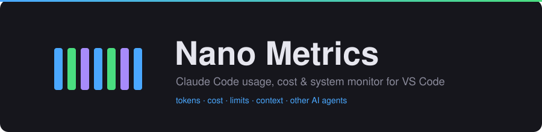
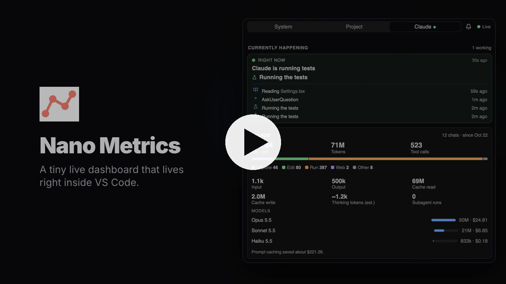
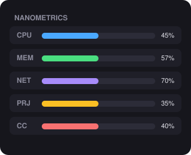
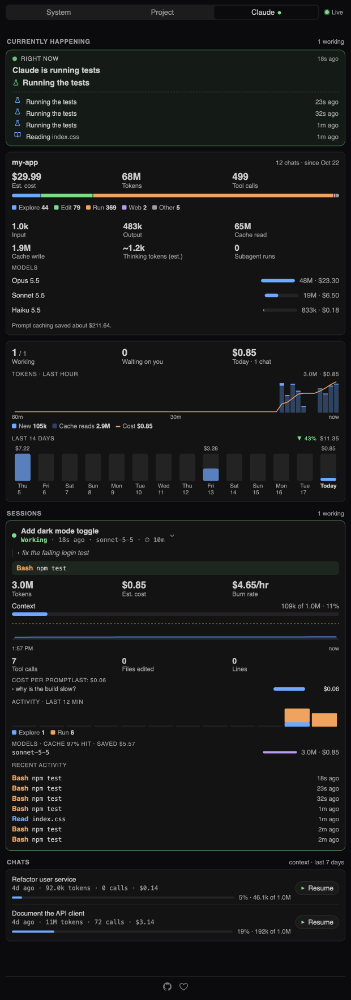
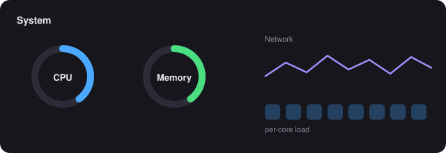

# Nano Metrics - VSCode Extension

  
  
  
  
  
  
  
  
  
  
  

  
   ▶ 40-second intro: what Nano Metrics is and why you'd want it

----

**Track Claude Code inside VS Code.** Nano Metrics shows what Claude Code is doing right now, and what it costs: live tokens, estimated cost and burn rate, context window fill, plan usage limits (5-hour and weekly), tool calls, subagents and edited files, per chat and for the whole project. Alerts tell you when a chat's context is nearly full or today's spend passes your budget.

It is also a lightweight **system and project monitor**: CPU, memory, temperature, network, top apps, listening ports and the dev servers, watchers and language servers your workspace runs, all in the sidebar.

Works with the Claude Code CLI and the Claude Code VS Code extension. Runs fully locally: no account, no telemetry, no network requests.

  

## Features

### Claude Code activity tracking

Watch your AI pair programmer work, without leaving the sidebar. The **Claude** tab follows every recent Claude Code session in your workspace:
- **Live status** - Working, **Your turn** (Claude finished and waits for your prompt), **Waiting on a tool** (a permission prompt or a long run) or Idle. The tab shows a dot when a session needs you, so you notice from any tab
- **Currently happening** - its own section at the top: one plain sentence like *Claude is writing code*, *Claude is searching the web*, *Claude is running tests* or *Claude is deploying*, then the last few moves. Made for anyone, no jargon
- **What it's doing right now** - the current tool call, and the last prompt you sent
- **Context meter** - how full the context window was on the latest request
- **Tokens, cost and burn rate** - total tokens, the estimated cost (what the usage would be billed through the Anthropic API) and $/hr. Override prices with `nanometrics.claudePricing`
- **Code stats** - tool calls, files edited, lines added / removed and failed tool calls
- **Activity chart** - tool calls per minute over the last 30 minutes, coloured by kind (explore, edit, run, web, agents)
- **Hot files** - the most edited files, click to open
- **Subagents and workflows** - every agent the session spawns, with running/done status, tool calls, tokens and cost; their usage is included in the session totals
- **Plan progress and recent activity** - Claude's task list with done/total, and the last actions with timestamps
- **Research trail** - every web search Claude ran and page it fetched (click to open the page)
- **Models and cache** - tokens and cost per model when you switch models, plus the cache hit rate and how much caching saved
- **Errors** - failed tool calls with their error message
- **Token graph** - tokens per minute over the last hour, across every session in the workspace
- **Daily spend** - estimated spend per day in this workspace, and today's total. Widen the panel and it shows more days (up to 60), not just the last 7
- **Project analytics** - every chat in this project: number of chats, estimated cost, total tokens and tool calls, the mix of tool kinds, input / output / cache tokens, thinking turns, subagent runs, the models used (tokens and cost each) and what prompt caching saved
- **Chats** - the last week's chats with their context fill, tool calls and cost; **Resume** opens a terminal with `claude --resume`
- **Claude Code load** - CPU and memory of the running `claude` processes against total system usage, and tokens per minute
- **Checkpoints and undo** - every recent prompt that changed files, with one-click **Undo** that restores those files to how they were before it (asks first, lists every file)
- **Stuck-loop detector** - flags a chat that keeps failing the same command or keeps editing one file while errors continue
- **Cost per prompt** - what each of your recent prompts cost (Claude's whole answer and its subagents), with expensive ones flagged red so you learn what to ask smaller
- **Plan vs API** - set `nanometrics.claudePlanPrice` (e.g. 20 for Pro) and the Claude tab shows what your last 7 days would have cost on the API against your plan, as a savings badge
- **Token and cost limits** - set a daily token limit, a daily cost limit and per-chat limits; you get a warning **with a sound** the moment one is passed
- **Alerts** - a heads-up when a new chat starts, when a chat's context passes 80%, or when a chat looks stuck. No "Claude is done" popups
- **Other AI helpers** - Codex CLI and Gemini CLI chats found on your machine, with tokens and cost per chat and today's total
- **Price list** - a built-in table of what each model charges per 1M tokens in, out and cached (Claude Fable, Opus, Sonnet, Haiku, plus GPT and Gemini), and `nanometrics.claudePricing` to override it
- **Ping** - a soft, short chime when a chat finishes or needs you. Turn it off with the bell in the top bar
- **Drag to rearrange** - grab the ⋮⋮ handle on any block of the Claude tab and drop it where you want; the order is remembered
- **Plan usage** - your Claude plan's 5-hour limit in the Explorer panel's **LIM** row, read from Claude Code's local cache (hover for the weekly limits and reset times)
- A **CC** row in the Explorer panel and a summary card on the Project tab show what Claude is doing at a glance

It reads Claude Code's local session transcripts (`~/.claude/projects`). Nothing is uploaded.

### System dashboard
- Live CPU and memory gauges with history graphs
- Per-core load heatmap and CPU temperature (where available)
- Network throughput (download / upload) for the default interface
- **Top apps** by CPU or memory, with helper processes folded into one row
- Load average, disk and swap usage, battery and GPU info
- Optional service monitoring: MySQL, Postgres, MongoDB, Redis, Docker, Nginx, Apache, Elasticsearch, RabbitMQ, Kafka, OracleDB, SQL Server, Neo4j, Cassandra, MariaDB, CouchDB, InfluxDB, ClickHouse, Memcached, etcd, Consul, ZooKeeper, Prometheus, Grafana, MinIO, HAProxy, Traefik, Ollama

### Project monitor
See what your open project is costing you, right next to your code:
- Every process tied to the workspace — anything running in VS Code terminals, processes whose working directory is inside the project, and the language servers / linters extensions run for this window
- Process trees with combined CPU and memory, so `npm run dev` shows the real cost of everything it spawned
- Listening ports for each process — click to open `localhost:<port>` in the browser
- Stop a process tree with one click
- Git branch and one-click `package.json` scripts (npm, yarn, pnpm or bun)

### Everywhere else
- Compact **NanoMetrics** panel in the Explorer — CPU, memory, temperature (macOS), network, project and Claude Code at a glance

- CPU and memory in the status bar, highlighted when usage crosses your warning threshold
- Uses your VS Code theme colors, light or dark

### Model prices (USD per 1M tokens)

| Model | In | Out | Cached in |
| --- | --- | --- | --- |
| Claude Fable 5.2 / 5.1 | $10 | $50 | $0.25 |
| Claude Opus 5.5 | $4 | $20 | $0.20 |
| Claude Opus 4.5 / 4.6 | $5 | $25 | $0.50 |
| Claude Opus 4.1 | $15 | $75 | $1.50 |
| Claude Sonnet 5.5 | $2 | $10 | $0.10 |
| Claude Sonnet 4.x | $3 | $15 | $0.30 |
| Claude Haiku 5.5 | $0.10 | $0.50 | $0.01 |
| Claude Haiku 4.5 | $1 | $5 | $0.10 |
| GPT-5 / GPT-5 Codex | $1.25 | $10 | $0.125 |
| GPT-5 mini | $0.25 | $2 | $0.025 |
| Gemini 2.5 Pro | $1.25 | $10 | $0.31 |
| Gemini 2.5 Flash | $0.30 | $2.50 | $0.075 |

Prices are list prices at the time of writing and may drift; override any of them with `nanometrics.claudePricing`. The Claude tab shows the same table.

## Installation

1. Open Visual Studio Code
2. Go to Extensions (or press `Ctrl+Shift+X`)
3. Search for "Nano Metrics"
4. Install the extension

## Usage

1. Click the Nano Metrics icon in the Activity Bar for the full dashboard, or use the **NanoMetrics** panel in the Explorer
2. Switch between the **System**, **Project** and **Claude** tabs
3. Click the status bar item to jump to the dashboard
4. Search for "Nano Metrics" in VS Code settings to tune it

| Setting | Default | Description |
| --- | --- | --- |
| `nanometrics.refreshInterval` | `2000` | Refresh interval in milliseconds |
| `nanometrics.showStatusBar` | `true` | Show CPU and memory in the status bar |
| `nanometrics.warningThreshold` | `85` | Usage % highlighted as a warning |
| `nanometrics.showGraph` | `true` | Show history graphs |
| `nanometrics.enableNetwork` / `enableDisk` | `true` | Network and disk sections |
| `nanometrics.enableGpu` / `enableBattery` | `false` | GPU and battery sections |
| `nanometrics.statusBarStyle` | `full` | `compact` shortens the status bar to e.g. `12·45%` |
| `nanometrics.claudePricing` | `{}` | Override model prices (USD per 1M tokens) for the cost estimate |
| `nanometrics.claudeContextWarning` | `80` | Warn once per chat when its context passes this %; `0` turns it off |
| `nanometrics.claudeDailyBudget` | `0` | Cost limit: warn (with sound) once a day when today's estimated spend (USD) passes this; `0` turns it off |
| `nanometrics.claudeDailyTokenLimit` | `0` | Token limit: warn (with sound) once a day when today's tokens pass this; `0` turns it off |
| `nanometrics.claudeSessionCostLimit` | `0` | Warn (with sound) once per chat when its estimated cost (USD) passes this |
| `nanometrics.claudeSessionTokenLimit` | `0` | Warn (with sound) once per chat when its tokens pass this |
| `nanometrics.claudePlanPrice` | `0` | Your monthly plan price in USD (Pro 20, Max 100/200) to show plan-vs-API value; `0` hides it |
| `nanometrics.claudeAlertSound` | `true` | Play a sound with limit and stuck-loop warnings (macOS, Linux, Windows) |
| `nanometrics.notifyClaudeSession` | `true` | Notify when a new Claude Code chat starts in the workspace |
| `nanometrics.claudeLoopWarning` | `true` | Warn when a chat looks stuck in a loop |
| `nanometrics.enable<Service>` | `false` | Monitor a background service |

Process working directories and ports are read with `lsof` on macOS and `/proc` on Linux. On Windows the project monitor relies on terminals and command lines.

## Privacy

**We don't receive your data. Nothing is sent anywhere.** Nano Metrics reads everything from your own machine and shows it in your own VS Code window. No server, no account, no telemetry, no analytics, and the extension makes no network requests at all.

What it reads, locally and read only:
- System stats (CPU, memory, disks, network, battery, GPU) from your operating system
- Processes, working directories and listening ports (`ps`, `lsof` on macOS, `/proc` on Linux)
- Your workspace's `package.json` scripts and current git branch
- Claude Code's session transcripts in `~/.claude/projects`, to show what Claude is doing, tokens and estimated cost
- The plan limits Claude Code last saved for `/usage` in `~/.claude.json`. Your login token is never read
- Codex CLI and Gemini CLI chats (`~/.codex/sessions`, `~/.gemini/tmp`), for tokens and cost

What it writes: nothing in your project or in your AI tools' files. Links open in your browser only when you click them.

**Every piece of code is open** at [github.com/nuhmanpk/nanometrics](https://github.com/nuhmanpk/nanometrics) under the MIT License. Don't take our word for it: read it, or build the extension from source. Full details in the [Privacy Policy](https://github.com/nuhmanpk/nanometrics/blob/main/PRIVACY.md).

## Contribution

Feel free to contribute to this project by reporting issues or submitting pull requests. Visit our [GitHub repository](https://github.com/nuhmanpk/nanometrics) to get involved. Your feedback and contributions mean a lot as we continue to enhance and improve Nano Metrics. This project is under active development, and your input is invaluable.

## Sponsor

If Nano Metrics helps you, consider supporting its development:

- [GitHub Sponsors](https://github.com/sponsors/nuhmanpk)
- [Buy Me a Coffee](https://buymeacoffee.com/nuhmanpk)

## License

This project is licensed under the MIT License - see the [LICENSE](https://github.com/nuhmanpk/nanometrics) file for details.

🚀 Happy coding !!!

